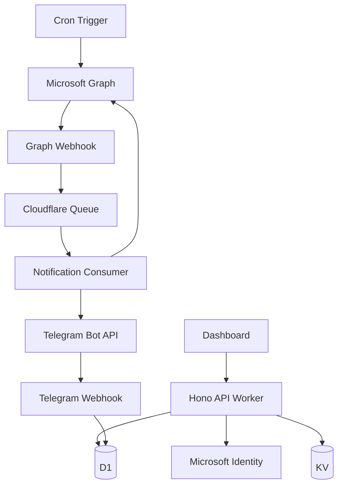

# 02. Thiết kế kỹ thuật

## 1. Stack và ràng buộc

- Ngôn ngữ: TypeScript strict mode.
- HTTP framework: Hono.
- Runtime/API: Cloudflare Workers.
- Frontend: lựa chọn tối giản tương thích Workers, ưu tiên Hono JSX hoặc React/Vite với Workers Assets; không thêm framework nặng nếu không cần.
- Database: Cloudflare D1.
- Async processing: Cloudflare Queues.
- Scheduler: Cron Triggers.
- Ephemeral/dedupe/link codes: Cloudflare KV.
- Secret bindings: Microsoft client secret, token encryption key, Telegram bot token, webhook secret.
- Package manager: pnpm.
- Validation: Zod hoặc validator tương đương có type inference.
- Test: Vitest và Cloudflare Workers test integration.

Không dùng Node-only API nếu runtime Workers không hỗ trợ hoặc chưa bật compatibility có chủ đích.

## 2. Kiến trúc logic



Có thể triển khai trong một Worker module với các handlers `fetch`, `queue`, `scheduled`, miễn mã nguồn được tách module rõ ràng. Không cần Durable Objects trong MVP.

## 3. Microsoft OAuth

### 3.1. Flow

1. `GET /auth/microsoft` tạo `state`, PKCE verifier/challenge nếu áp dụng, nonce và return path an toàn.
2. Lưu state ngắn hạn, HttpOnly session hoặc KV với TTL.
3. Redirect tới Microsoft authorize endpoint.
4. Callback kiểm tra state/nonce, đổi code lấy token từ backend.
5. Lấy profile tối thiểu.
6. Mã hóa refresh token và lưu connection.
7. Tạo Graph subscription.
8. Redirect dashboard.

### 3.2. Token lifecycle

- Không dựa vào access token lâu dài; refresh khi hết hạn/gần hết hạn.
- Nếu Microsoft token response trả refresh token mới, thay thế atomically.
- Dùng single-flight/best-effort lock để tránh nhiều job đồng thời refresh cùng connection.
- Phân loại `invalid_grant` thành `reauthorization_required`; không retry vô hạn.
- Không log token response.

### 3.3. Permission

MVP bắt đầu với:

```text
openid profile offline_access User.Read Mail.ReadBasic
```

Trước khi code cố định, phải chạy proof-of-concept xác nhận `Mail.ReadBasic` đáp ứng:

- Tạo subscription cho message.
- GET message với `$select=id,subject,from,sender,receivedDateTime,webLink` hoặc tập con được hỗ trợ.

Nếu một trường không được phép, ưu tiên bỏ trường khỏi notification. Chỉ nâng thành `Mail.Read` sau khi chủ sản phẩm xác nhận bằng văn bản.

## 4. Graph subscription

Payload dự kiến:

```json
{
  "changeType": "created",
  "notificationUrl": "https://<domain>/webhooks/microsoft",
  "lifecycleNotificationUrl": "https://<domain>/webhooks/microsoft/lifecycle",
  "resource": "/me/mailFolders('inbox')/messages",
  "expirationDateTime": "<within-current-Graph-limit>",
  "clientState": "<random-secret>"
}
```

`<domain>` là placeholder contract. URL public cụ thể chỉ được ánh xạ ở Chặng 7 sau khi logic và hardening hoàn tất.

Không hard-code thời hạn tối đa từ trí nhớ. Triển khai một hằng cấu hình bảo thủ và xác minh theo tài liệu Microsoft Graph tại thời điểm code; gia hạn với buffer đủ lớn.

### 4.1. Validation request

- Nếu query có `validationToken`, trả `200 text/plain` với token nguyên dạng.
- Không bọc JSON, không encode thêm.
- Không chạy middleware auth người dùng trên route này.

### 4.2. Notification request

- Parse body với giới hạn kích thước.
- Duyệt từng item trong `value`.
- Lookup subscription nội bộ.
- So sánh client state; lưu hash/HMAC thay vì secret rõ nếu thiết kế cho phép xác minh.
- Chỉ chấp nhận change type/resource phù hợp.
- Enqueue job tối thiểu.
- Trả `202` hoặc mã thành công phù hợp ngay.

Job mẫu, tuyệt đối không thêm subject/sender:

```ts
type MailNotificationJob = {
  version: 1;
  userId: string;
  subscriptionId: string;
  resourceId: string;
  receivedAt: string;
  correlationId: string;
};
```

### 4.3. Lifecycle recovery

- `reauthorizationRequired`: thử reauthorize subscription bằng token hợp lệ; nếu token invalid, đổi connection sang trạng thái yêu cầu đăng nhập lại.
- `subscriptionRemoved`: tạo subscription mới nếu connection và user vẫn active.
- `missed`: do app không lưu hoặc đồng bộ lịch sử, chạy delta/catch-up giới hạn có rủi ro gửi notification muộn. MVP phải chọn chính sách sau:
  - Khuyến nghị: delta/catch-up chỉ từ checkpoint kỹ thuật gần nhất và chỉ gửi item mới hơn cửa sổ tối đa cấu hình (ví dụ 15 phút).
  - Không bao giờ lưu metadata item từ delta.
  - Nếu chưa có checkpoint đáng tin cậy, tạo lại subscription và ghi metric `missed_unrecovered`; không quét toàn mailbox.

Chính sách này tránh mất riêng tư và tránh “bão notification” sau downtime.

## 5. Queue consumer

Trình tự bắt buộc:

1. Load user/connection/subscription theo ID kỹ thuật.
2. Nếu user không `active`, ACK và bỏ job.
3. Kiểm tra dedupe “sent”; nếu có, ACK.
4. Lấy access token hợp lệ.
5. GET Graph message với `$select` tối thiểu.
6. Nếu 404 do item đã move/delete, ACK và tăng metric kỹ thuật.
7. Format notification trong memory.
8. Gọi Telegram `sendMessage`.
9. Nếu thành công, ghi dedupe TTL và cập nhật `last_success_at`.
10. Xóa reference/payload khỏi scope sớm nhất có thể; tuyệt đối không log.

### Retry policy

- Graph/Telegram `429`: tôn trọng `Retry-After` hoặc `retry_after` trong giới hạn Queue.
- `5xx`, timeout, network: exponential backoff + jitter.
- `401`: thử refresh đúng một lần; nếu vẫn lỗi, yêu cầu reauthorization và ACK/dead-letter kỹ thuật.
- Telegram `403 bot blocked`: đánh dấu destination unreachable, không retry.
- Validation/format `4xx`: không retry trừ trường hợp được liệt kê.

## 6. Telegram integration

### 6.1. Bot chung

- Bot tạo qua BotFather và do hệ thống sở hữu.
- Token chỉ nằm trong Workers Secret.
- Ở Chặng 0–6 chỉ test adapter/fixture. Chặng 7 mới gọi `setWebhook` bằng URL và secret runtime ngoài repo.
- Telegram webhook kiểm tra secret header, content type và body size.
- Bot hỗ trợ `/start`, `/help`, `/settings` ở mức tối thiểu.

### 6.2. Account linking

KV key:

```text
telegram-link:<opaque-code> -> { userId, expiresAt }
```

- Code tối thiểu 128 bit entropy, base64url, không chứa user ID.
- TTL tối đa 10 phút.
- Khi `/start code` đến, consumer/handler dùng thao tác đảm bảo one-time tốt nhất có thể; kiểm tra user chưa liên kết destination xung đột.
- Lưu `chat_id` dưới dạng string để tránh vấn đề integer precision.
- Sau thành công, xóa key và gửi xác nhận.

### 6.3. Notification formatting

MVP dùng plain text. Giới hạn/chuẩn hóa:

- Strip/control characters nguy hiểm.
- Cắt subject/sender theo giới hạn nội bộ hợp lý.
- Toàn message phải nằm dưới giới hạn Telegram hiện hành.
- Không gửi body preview.
- Không dùng URL lấy từ email content.

## 7. Dedupe và tính nhất quán

Telegram `sendMessage` không cung cấp idempotency key end-to-end cho nghiệp vụ này. Vì vậy exactly-once tuyệt đối không thể cam kết khi worker crash sau Telegram success nhưng trước khi ghi dedupe.

Cam kết sản phẩm phải là at-least-once delivery với best-effort deduplication. Tài liệu/UI không được tuyên bố “không bao giờ trùng”. Thiết kế ưu tiên tránh bỏ sót nhưng chấp nhận xác suất nhỏ gửi trùng khi lỗi phân tán.

## 8. Cron jobs

Một scheduled handler có thể điều phối:

- Gia hạn subscription sắp hết hạn.
- Tạo lại subscription bị removed/degraded.
- Dọn link code/dữ liệu TTL nếu cần.
- Health metrics không chứa dữ liệu email.

Cron phải phân trang user, giới hạn concurrency và tránh một invocation xử lý toàn bộ dữ liệu không giới hạn. Với quy mô lớn, enqueue renewal jobs thay vì renew tuần tự trong Cron.

## 9. Không lưu trữ email — ranh giới kỹ thuật

Được phép:

- Dữ liệu email tồn tại tạm thời trong biến của Queue consumer.
- Resource/message ID trong queue job và dedupe key có TTL.
- Timestamp thành công/thất bại.
- Mã lỗi đã chuẩn hóa.

Không được phép:

- Graph raw response trong database/log/error tracker.
- Subject/sender trong Queue retry metadata, DLQ hoặc trace span.
- Telegram text trong log.
- Cache message metadata.
- Analytics event chứa domain người gửi hoặc subject.

## 10. Tài liệu chính thức cần Codex kiểm tra khi triển khai

- Microsoft Graph Outlook change notifications: https://learn.microsoft.com/en-us/graph/outlook-change-notifications-overview
- Graph webhook delivery: https://learn.microsoft.com/en-us/graph/change-notifications-delivery-webhooks
- Graph lifecycle events: https://learn.microsoft.com/en-us/graph/change-notifications-lifecycle-events
- Microsoft authorization code flow: https://learn.microsoft.com/en-us/entra/identity-platform/v2-oauth2-auth-code-flow
- Telegram Bot API: https://core.telegram.org/bots/api
- Telegram deep linking: https://core.telegram.org/bots/features#deep-linking
- Hono on Workers: https://developers.cloudflare.com/workers/framework-guides/web-apps/more-web-frameworks/hono/
- Cloudflare Queues: https://developers.cloudflare.com/queues/
- Cron Triggers: https://developers.cloudflare.com/workers/configuration/cron-triggers/
