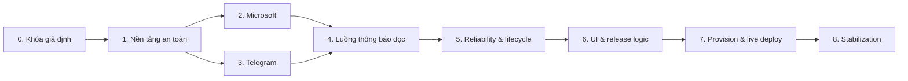

# Roadmap phát triển Outlook → Telegram Notifier

## 1. Mục đích

Roadmap này chia MVP thành các chặng có thứ tự, dependency và cổng nghiệm thu rõ ràng. Đây là tài liệu điều phối cấp dự án, dùng làm đầu vào để lập từng implementation plan nhỏ trong `plans/`; không thay thế đặc tả sản phẩm, thiết kế kỹ thuật hay test runbook.

Nguồn yêu cầu:

- `README.md`: mục tiêu, quyết định đã chốt, giới hạn MVP.
- `docs/01-product-requirements.md`: user journey, FR/NFR, edge cases, Definition of Done.
- `docs/02-technical-design.md`: kiến trúc, data flow, integration policy.
- `docs/03-api-data-security.md`: API, schema, threat model, retention.
- `docs/04-implementation-test-runbook.md`: test pyramid, CI/CD, vận hành, rollback.

## 2. Nguyên tắc thực thi

- Đi tuần tự theo cổng chặng logic. Claim chỉ có thể xác minh bằng môi trường thật phải được đánh dấu `provisional`, cô lập sau adapter và chặn release tại Chặng 7.
- Từ Chặng 0 đến Chặng 6 chỉ dùng placeholder, fake client, fixture và contract test. Không provision hoặc điền URL, tenant/app/client ID, resource ID, bot token hay secret thật vào repo.
- Ưu tiên một Worker module, ít dependency, không thêm Durable Objects trong MVP.
- Mỗi plan nhỏ tạo ra một deliverable kiểm chứng được và giữ repo ở trạng thái build/test được.
- Test và kiểm soát quyền riêng tư nằm trong từng chặng, không dồn về cuối.
- Không mở rộng Microsoft permission hoặc phạm vi lưu dữ liệu nếu chưa có quyết định bằng văn bản.
- Không coi Telegram delivery là exactly-once tuyệt đối; ghi rõ giới hạn best-effort dedupe.
- Version 1.1 và Version 2 chỉ là backlog định hướng, không chen vào critical path của MVP.

## 3. Bản đồ chặng

| Chặng | Kết quả chính | Phụ thuộc | Cổng chuyển chặng |
|---|---|---|---|
| 0. Khóa contract | ADR, official-contract audit và harness cho rủi ro ngoài hệ thống | Không | Contract đã khóa hoặc đánh dấu provisional với fallback rõ ràng |
| 1. Nền tảng an toàn | Worker local chạy được, binding contracts, schema, session shell, CI | Chặng 0 | Build/typecheck/test/migration dry-run đạt; logger không rò rỉ dữ liệu |
| 2. Logic Microsoft | OAuth, token mã hóa, subscription và webhook qua fake/contract tests | Chặng 1 | Contract tests đạt; forged webhook không enqueue; chưa cần credential thật |
| 3. Logic Telegram | Deep link one-time, webhook, destination và test-message adapter | Chặng 1 | Fixture/concurrency tests đạt; chưa cần bot hoặc webhook thật |
| 4. Luồng thông báo dọc | Graph webhook → Queue → Graph fetch → Telegram qua integration harness | Chặng 2, 3 | Vertical slice giả lập đạt; không lưu/log email metadata |
| 5. Độ tin cậy và vòng đời | Renewal, recovery, dedupe, retry, deletion, kill switch | Chặng 4 | Failure matrix và acceptance tests trọng yếu đạt |
| 6. Sản phẩm và release logic | Landing/dashboard/settings/privacy + release checklist | Chặng 5 | User journey qua test harness và security/privacy audit đạt |
| 7. Provision, deploy và live validation | Điền runtime values ngoài repo, deploy test thật, live E2E và rollback | Chặng 6 | Graph/Telegram live gate, AT-01..12, privacy scan và rollback đạt |
| 8. Ổn định sau phát hành | Theo dõi, sửa lỗi, xác nhận SLO và chi phí | Chặng 7 | MVP ổn định trong cửa sổ quan sát đã chọn |

Luồng dependency chính:



Chặng 2 và 3 độc lập về nghiệp vụ sau khi Chặng 1 hoàn tất, nhưng mặc định vẫn dev tuần tự để giảm context switching. Chỉ chạy song song khi đã chia ownership file rõ ràng trong plan chi tiết.

## 4. Chi tiết từng chặng

### Chặng 0 — Khóa giả định và quyết định kiến trúc

**Status (2026-07-15):** Graph official-contract audit và ADR đã có; Telegram contract audit/ADR còn phải hoàn tất. Live PoC được chủ động dời sang Chặng 7. Kết luận phụ thuộc hành vi thật giữ trạng thái `provisional` và không chặn Foundation, nhưng vẫn chặn release.

**Mục tiêu:** loại bỏ sớm các rủi ro có thể làm đổi permission, schema hoặc recovery policy.

**Phạm vi:**

- Xác minh bằng tài liệu chính thức và contract harness rằng `Mail.ReadBasic` là baseline hợp lý; giữ adapter cho fallback đã phê duyệt nếu live gate thất bại.
- Ghi nhận resource/message ID thực nhận từ change notification.
- Xác minh thời hạn subscription, validation contract và lifecycle notification hiện hành.
- Xác minh Telegram `setWebhook`, secret header, deep link `/start` và `sendMessage`.
- Chốt Entra app single-tenant hay multi-tenant.
- Chốt chính sách `missed`: catch-up giới hạn hay recreate + `missed_unrecovered`.
- Chốt tập trường notification cuối cùng; nếu `webLink` không khả dụng thì bỏ khỏi MVP.

**Deliverables:**

- ADR về tenant model.
- ADR về Graph permission và tập trường cho phép.
- ADR về subscription/lifecycle/missed policy.
- Harness/fixture không chứa dữ liệu thật; danh sách claim cần live validation ở Chặng 7.

**Exit gate:** mọi contract có nguồn, test seam và fallback/decision owner; claim chưa test live được ghi `provisional`. Không được tuyên bố M0 đã live-verified.

**Các plan nhỏ nên lập:**

1. `graph-permission-subscription-spike`.
2. `telegram-webhook-deep-link-spike`.
3. `architecture-decisions-baseline`.

### Chặng 1 — Nền tảng an toàn và có thể kiểm thử

**Mục tiêu:** tạo skeleton production-shaped trước khi thêm integration thật.

**Phạm vi:**

- Khởi tạo TypeScript strict, Hono, Workers, pnpm và cấu trúc module tối giản.
- Cấu hình D1, KV, Queue, DLQ, Cron và secret placeholders.
- Tạo migrations cho user, connection, subscription, Telegram destination, settings và delivery status.
- Env validation, error taxonomy, correlation ID và logging allowlist.
- Session shell, cookie security, CSRF strategy cho mutation.
- Test harness Workers, lint/typecheck/test/build và CI gates.
- System-wide notification kill switch ở mức cấu hình, mặc định an toàn.

**Không thuộc chặng:** OAuth hoàn chỉnh, gọi Graph/Telegram thật, dashboard hoàn chỉnh.

**Exit gate:** chạy local/Miniflare được; migration dry-run sạch; CI xanh; test chứng minh logger không ghi raw payload/token/email fields. Chưa provision Cloudflare resource thật.

**Các plan nhỏ nên lập:**

1. `worker-project-foundation`.
2. `d1-schema-and-repositories`.
3. `session-errors-and-safe-logging`.
4. `test-and-ci-baseline`.

### Chặng 2 — Kết nối Microsoft end-to-end

**Mục tiêu:** người dùng kết nối mailbox của chính họ và hệ thống duy trì Graph subscription an toàn.

**Phạm vi:**

- OAuth start/callback với state, nonce, PKCE khi áp dụng và redirect allowlist.
- Profile tối thiểu, connection persistence và settings mặc định.
- AES-GCM envelope, key version và refresh-token replacement atomically.
- Graph adapter cho token refresh và subscription create/delete/renew.
- Microsoft webhook validation token, batch envelope và `clientState` verification.
- Disconnect: cố xóa subscription từ Graph, luôn xóa token cục bộ.
- Trạng thái `microsoft_disconnected`, `reauthorization_required`, `subscription_degraded`.

**Không thuộc chặng:** fetch nội dung message để gửi Telegram; lifecycle recovery đầy đủ; UI polish.

**Exit gate:** AT-01 và phần Microsoft của AT-12 đạt bằng fake upstream/contract integration; token mã hóa trong D1 test; webhook giả không enqueue. OAuth/subscription live dời Chặng 7.

**Các plan nhỏ nên lập:**

1. `microsoft-oauth-and-session`.
2. `token-encryption-and-refresh`.
3. `graph-subscription-management`.
4. `microsoft-webhook-ingress`.
5. `microsoft-disconnect-and-reauth-state`.

### Chặng 3 — Kết nối Telegram end-to-end

**Mục tiêu:** liên kết private chat mà người dùng không phải nhập `chat_id`.

**Phạm vi:**

- Telegram adapter cho `getMe` và `sendMessage`.
- Webhook secret validation và runtime schema validation.
- One-time opaque code trong KV, TTL tối đa 10 phút.
- Deep link, `/start <code>`, consume-once và binding destination.
- Test notification không dùng email thật.
- Disconnect và trạng thái `telegram_disconnected`/`telegram_unreachable`.
- Rate limit/cooldown cho link và test endpoints.

**Không thuộc chặng:** group chat, bot riêng, notification từ email thật.

**Exit gate:** AT-02 và phần Telegram của AT-12 đạt bằng fixture/fake adapter; code hết hạn/tái sử dụng bị từ chối; không cần bot token thật. Live bot/deep link dời Chặng 7.

**Các plan nhỏ nên lập:**

1. `telegram-adapter-and-webhook`.
2. `telegram-one-time-linking`.
3. `telegram-test-disconnect-and-abuse-control`.

### Chặng 4 — Luồng thông báo dọc tối thiểu

**Mục tiêu:** chứng minh core value bằng một vertical slice hoàn chỉnh.

**Phạm vi:**

- Graph webhook hợp lệ enqueue job chỉ chứa ID kỹ thuật.
- Consumer kiểm tra user đang `active` trước khi fetch metadata.
- Refresh access token, GET `$select` tối thiểu, xử lý message đã move/delete.
- Formatter plain text, timezone, missing values, truncation và control characters.
- Gửi Telegram rồi cập nhật delivery status kỹ thuật.
- KV dedupe TTL; chỉ đánh dấu sent sau Telegram success.
- Phân loại retry cơ bản cho network, `429`, `5xx`, auth và blocked chat.
- Kiểm tra D1/KV/log/trace/DLQ không chứa sender, subject, body hoặc Telegram text.

**Exit gate:** AT-03 đến AT-09 và AT-11 đạt ở mức phù hợp; p95 nội bộ đo được; giới hạn double-send do crash đã được ghi rõ.

**Các plan nhỏ nên lập:**

1. `graph-webhook-queue-contract`.
2. `minimal-message-fetch-and-formatting`.
3. `telegram-delivery-and-error-classification`.
4. `dedupe-and-delivery-status`.
5. `notification-pipeline-integration-tests`.

### Chặng 5 — Reliability, lifecycle và hardening

**Mục tiêu:** hệ thống tự phục hồi có giới hạn, ngừng an toàn và vận hành được khi upstream lỗi.

**Phạm vi:**

- Cron renewal có pagination, buffer và update atomically.
- Lifecycle events: `reauthorizationRequired`, `subscriptionRemoved`, `missed` theo ADR.
- Backoff + jitter, `Retry-After`, retry budget và DLQ chỉ chứa ID kỹ thuật.
- Single-flight/best-effort lock cho refresh token và race-condition tests.
- Disable/disconnect/account deletion có hiệu lực với job đang chờ.
- Feature flag/kill switch cho consumer delivery.
- Metrics low-cardinality, alerts, incident runbook và key/token rotation rehearsal.
- Security review theo threat model; privacy/data-retention audit tự động nơi khả thi.

**Exit gate:** AT-07 đến AT-10 đạt; chaos/failure scenarios chính đạt; subscription tự renew/recover; account deletion và kill switch được diễn tập.

**Các plan nhỏ nên lập:**

1. `subscription-renewal-and-lifecycle-recovery`.
2. `queue-retry-dlq-and-backpressure`.
3. `disconnect-disable-and-account-deletion`.
4. `observability-alerting-and-kill-switch`.
5. `security-privacy-hardening`.

### Chặng 6 — Trải nghiệm sản phẩm và phát hành MVP

**Mục tiêu:** hoàn thiện user journey và release logic trước khi kết nối hạ tầng thật.

**Phạm vi:**

- Landing, Microsoft login, dashboard trạng thái và connection actions.
- Settings `enabled`, `showSender`, `showSubject`, `timezone`.
- UX cho reauthorization, degraded subscription, unreachable Telegram và moved-to-Inbox limitation.
- Privacy disclosure/consent copy; không hiển thị email event history.
- Hướng dẫn placeholder cho Entra, BotFather, Workers bindings và local setup; chưa điền giá trị thật.
- E2E qua test harness và chuẩn bị checklist migration/deploy/rollback.
- Security/privacy sign-off và checklist bàn giao.

**Exit gate:** user journey 1–10 chạy qua test harness; UI/security/privacy checklist đạt. Definition of Done live và rollback rehearsal thuộc Chặng 7.

**Các plan nhỏ nên lập:**

1. `dashboard-and-settings-ui`.
2. `connection-state-and-recovery-ux`.
3. `privacy-consent-and-help-content`.
4. `mvp-release-readiness-review`.

### Chặng 7 — Provision runtime, deploy test thật và live validation

**Mục tiêu:** chỉ sau khi logic/hardening/UI hoàn thiện mới ánh xạ placeholder sang runtime values, deploy môi trường test production-like và quyết định go/no-go.

**Phạm vi:**

- Inventory và provision Entra tenant/app/test mailboxes, Telegram test bot/accounts, Cloudflare Worker/D1/KV/Queue/DLQ/Cron/routes.
- Điền `APP_BASE_URL`, tenant model/value, client ID, redirect URI, Graph notification/lifecycle URLs, bot username và binding/resource IDs qua secret manager/Workers bindings; không ghi giá trị thật vào repo/docs.
- Apply migrations, deploy Worker, đăng ký Graph/Telegram webhooks và chạy live PoC đã hoãn.
- Chạy AT-01..12, email-to-Telegram E2E, privacy scan D1/KV/Queue/log/DLQ, smoke test, rollback/teardown và rotation rehearsal.
- Chốt hoặc sửa các ADR `provisional`, đặc biệt permission `Mail.ReadBasic`/`Mail.Read` và platform behavior.

**Exit gate:** toàn bộ live gate có bằng chứng đã khử nhạy cảm; không có secret/identifier trong git; rollback thành công; mọi ADR provisional đã được chốt hoặc release bị dừng.

**Các plan nhỏ nên lập:**

1. `runtime-provisioning-and-secret-inventory`.
2. `production-like-deployment-and-live-poc`.
3. `live-e2e-privacy-and-rollback-gate`.

### Chặng 8 — Ổn định sau phát hành

**Mục tiêu:** xác nhận hệ thống đáp ứng độ tin cậy, quyền riêng tư và chi phí trong thực tế trước khi mở rộng tính năng.

**Phạm vi:**

- Theo dõi error rate, queue age, renewal failure, reauthorization và Telegram throttling.
- Đo p95 từ webhook accepted tới Telegram accepted.
- Kiểm tra mẫu log/DLQ định kỳ để phát hiện rò rỉ dữ liệu.
- Triage lỗi theo severity; chỉ sửa reliability/security/privacy trong cửa sổ ổn định.
- Ghi baseline chi phí Workers, D1, KV, Queue theo active user/event volume.
- Tổng kết release và quyết định có mở Version 1.1 hay chưa.

**Exit gate:** không còn lỗi critical/high chưa xử lý; SLO và privacy invariant ổn định trong cửa sổ do chủ sản phẩm chốt.

**Các plan nhỏ nên lập:**

1. `post-release-observation-and-slo-baseline`.
2. `mvp-stabilization-fixes` khi có finding cụ thể.
3. `mvp-retrospective-and-v1-1-go-no-go`.

## 5. Quy ước tạo implementation plan sau này

Mỗi plan trong `plans/{timestamp}-{slug}/` nên:

- Chỉ thuộc một chặng và tạo một outcome có thể demo/test độc lập.
- Ghi rõ roadmap chặng, FR/NFR/AT liên quan và dependency plan trước đó.
- Có phạm vi ngoài plan để tránh kéo nhầm việc từ chặng sau.
- Nêu file dự kiến create/modify, migration/binding ảnh hưởng và rollback.
- Có test gate: unit, integration, E2E hoặc manual PoC phù hợp.
- Có privacy gate bắt buộc nếu đụng Graph payload, Queue, D1, KV, log, DLQ hoặc Telegram text.
- Kết thúc bằng bằng chứng nghiệm thu, không chỉ checklist “đã code”.

Template scope tối thiểu:

```text
Roadmap stage:
Outcome:
In scope:
Out of scope:
Dependencies / blockedBy:
Decisions already locked:
Files and bindings affected:
Implementation steps:
Test and privacy gates:
Rollback:
Acceptance evidence:
Open questions:
```

Không lập một plan duy nhất cho toàn bộ Chặng 2–6. Plan quá rộng làm mất review gate, khó rollback và dễ trộn dữ liệu nhạy cảm vào hạ tầng chưa được kiểm chứng.

## 6. Cổng chất lượng xuyên suốt

Một plan không được đóng nếu vi phạm bất kỳ invariant nào:

- Không có email subject/sender/body/recipient/attachment trong persistent storage, logs, analytics hoặc DLQ.
- Không có secret/token trong source, frontend bundle, fixture hoặc CI artifact.
- Mọi external payload được runtime-validate.
- Mọi mutation user-scoped chống IDOR và CSRF theo session model.
- Queue job chỉ chứa ID kỹ thuật; consumer luôn re-check trạng thái user.
- Permission vẫn ở `Mail.ReadBasic`, trừ khi có ADR và phê duyệt thay đổi.
- `pnpm lint`, `pnpm typecheck`, `pnpm test`, `pnpm build` đều đạt từ khi các command tồn tại.
- Migration bất biến và deploy/rollback tương thích ít nhất một phiên bản.

## 7. Mốc phát hành

| Mốc | Bao gồm | Ý nghĩa |
|---|---|---|
| M0 — Contract baseline | Chặng 0 | Contract/ADR đủ để code; live-dependent claims còn provisional |
| M1 — Connections logic ready | Chặng 1–3 | Microsoft và Telegram logic độc lập đạt contract tests |
| M2 — Core value simulated | Chặng 4 | Pipeline chuẩn đạt integration harness, chưa tuyên bố live |
| M3 — Release candidate | Chặng 5–7 | Reliability, UI, privacy, live deploy và rollback đã đạt |
| M4 — MVP stable | Chặng 8 | Đủ bằng chứng để cân nhắc Version 1.1 |

## 8. Rủi ro điều phối chính

| Rủi ro | Ảnh hưởng roadmap | Biện pháp |
|---|---|---|
| `Mail.ReadBasic` thiếu trường/API | Có thể đổi notification hoặc permission | Chặn tại Chặng 0; ưu tiên bỏ trường, không tự nâng quyền |
| Chính sách `missed` chưa chốt | Không thể hoàn thiện lifecycle recovery | ADR tại Chặng 0 trước plan recovery |
| Crash sau Telegram success | Có thể gửi trùng | Công bố best-effort; dedupe + metric + test race |
| Hoãn public HTTPS làm tăng rủi ro rework permission/API | Mock không chứng minh hành vi platform thật | Pin official contracts, cô lập adapter, đánh dấu provisional và bắt buộc go/no-go ở Chặng 7 |
| Test integration vô tình lưu payload | Vi phạm privacy dù production code đúng | Fixture giả, logger allowlist, scan D1/KV/log/DLQ trong test |
| UI làm trước state machine ổn định | Rework và che lỗi backend | UI hoàn chỉnh sau reliability gate; chỉ shell tối thiểu trước đó |

## 9. Quyết định còn mở

Các câu hỏi này không chặn việc dùng roadmap, nhưng chặn plan tương ứng:

1. Entra app là single-tenant hay multi-tenant?
2. Khi nhận lifecycle event `missed`, MVP dùng catch-up giới hạn hay recreate subscription và ghi `missed_unrecovered`?
3. Cửa sổ dedupe chính thức là 24, 48 hay 72 giờ?
4. Cửa sổ quan sát để tuyên bố M4 ổn định là bao lâu, và ngưỡng SLO/error budget cụ thể là gì?
5. Frontend chọn Hono JSX hay React/Vite Workers Assets sau khi xác định độ phức tạp dashboard?
6. `chat_title` có cần lưu hay bỏ để tối thiểu hóa dữ liệu Telegram?

## 10. Điểm bắt đầu đề xuất

Plan triển khai đầu tiên nên là `graph-permission-subscription-spike` thuộc Chặng 0. Nó có blast radius thấp nhưng quyết định trực tiếp permission, notification fields và khả năng tiếp tục toàn bộ roadmap.
